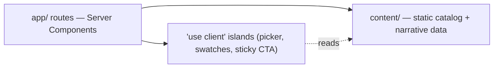
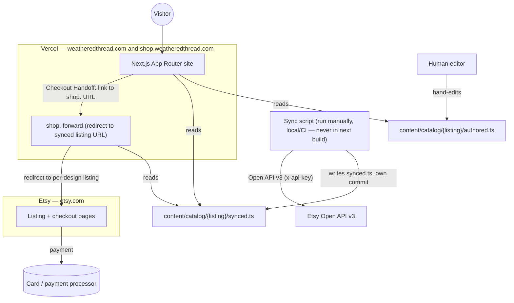

# Architecture Spine — Weathered Thread

## Design Paradigm

**Server-Components-first App Router.** React Server Components render by default for every route; `'use client'` is an explicit opt-in reserved for interactive picker state — motif selection, garment color/size selection, the live preview-image swap between synced/placeholder photos, and the sticky mobile Add-to-Bag bar (state ownership: AD-8). No global client-side store: interactivity is local component state, scoped to the Product and Collection Story surfaces `EXPERIENCE.md` defines.

Next.js 16's `cacheComponents` flag (unifies PPR/`use cache`/`dynamicIO`) stays **off** for v1: nothing on this site fetches per-request dynamic data — the catalog is build-time-synced static content (AD-2/AD-3) and there are no accounts (AD-5) — so default static rendering already covers it. Revisit only if a future feature needs per-request dynamic data mixed with a static shell.



## Invariants & Rules

### AD-1 — Etsy is payment-only; no shared cart

- **Binds:** all
- **Prevents:** any attempt to call an Etsy cart/checkout endpoint from the custom site, or to hold cart/order state on this side of the boundary. Cart and checkout run entirely on etsy.com. "No integration" here means specifically cart/session/checkout — AD-2's one-way catalog sync and AD-6's email send are separate, explicitly-scoped integrations, not exceptions to this AD.
- **Rule:** The custom site owns 100% of browsing, storytelling, and the garment×motif picker. The only integration point is outbound: a Checkout Handoff surface links to a `shop.weatheredthread.com` URL (served by this app, see AD-7) that forwards to the synced Etsy listing URL of the selected motif's listing. Handoff links in site markup always use the `shop.` host — never a raw etsy.com URL. An Etsy listing URL is per design (motif), so the handoff cannot preselect style, color, or size: the interstitial restates the selection and the visitor confirms it on Etsy. Nothing reads or writes Etsy cart/session state. The synced listing `url` field (from Etsy's Open API v3 — see AD-2) is the single source of truth for the forward's target; the sync script validates, at sync time, that its host is etsy.com (or a subdomain) and fails loudly otherwise. The forward resolves the target from stored synced data — it is never constructed or rewritten client-side. The raw Etsy `url` is read server-side only, by the forward; it is never passed as a prop to a Client Component or otherwise serialized into a client payload (NFR8).

### AD-2 — Etsy is commerce source of truth; synced, not duplicated

- **Binds:** catalog data (content/)
- **Prevents:** price, inventory, or listing name hand-maintained in two independently-updated places and drifting apart; synced and hand-authored data overwriting each other; a "runs during `next build`" reading that silently discards its own output on Vercel's ephemeral build filesystem; a stale sync snapshot regressing newer data via out-of-order commits; a partial/corrupt write on API failure.
- **Rule:** The commerce catalog is one Etsy `listing` per design (motif), with three variation axes: garment style (long-sleeve tee, short-sleeve tee, heavyweight crew, lightweight crew), color (ivory, pepper, blue jean), and size (S/M/L on tees). Motif is therefore present in the commerce source, one listing per motif (see Naming). `product` (garment × motif) is still assembled in-repo; every product of a motif shares that motif's listing URL. The join key between a repo motif and its Etsy listing is an open architecture item, to be decided in the sync story (see Deferred).

  The sync script (`scripts/sync-etsy.ts`) is run **manually, locally or in a one-off CI job — never from `next build` or any Vercel build/runtime step.** It calls Etsy's Open API v3, sending `x-api-key: <keystring>:<shared_secret>` on every call (the public read-only endpoints it uses need no OAuth), fetches price, inventory, name, and listing `url`, and writes them to `content/catalog/{listing}/synced.ts` — a file it fully owns and overwrites on every run, all-or-nothing (on any fetch error it writes nothing rather than a partial file). It never writes to `content/catalog/{listing}/authored.ts`, which only a human edits (motif name, place/story copy, collection grouping); a per-listing `index.ts` re-exports the merge of both. A sync run's output is always its own catalog-only commit — never bundled into a feature branch — and the script diffs against `main`'s current tip before writing, so a stale snapshot can't silently regress newer data. No runtime call to Etsy from a visitor-facing request. Sync cadence is manual for v1 (see Deferred).

### AD-3 — Catalog is static content, not a database

- **Binds:** all data access
- **Prevents:** introducing a database, ORM, or CMS for a small, batch-updated catalog.
- **Rule:** All catalog and narrative content is TypeScript/JSON modules under `content/`, imported at build/request time. No server-side mutation endpoints for catalog data. (Current scale: on the order of one Etsy listing per authored Sea Isle motif, 13 today; final garment×motif product count is still open, see Deferred — this AD holds regardless of that count landing somewhat higher.)

### AD-4 — Product images are repo-static

- **Binds:** all product/motif imagery
- **Prevents:** premature introduction of an external asset store (Blob/S3) before it's earned; mismatched image-field shapes between the entities that produce and consume them.
- **Rule:** Images live under `public/` (or content-colocated), referenced by path from `content/catalog/`. Closed set of image fields — no others added without a spine update: every `garment` carries one `swatchImage`; every `product` (garment×motif) carries one `previewImage` (the on-garment composite, placeholder-composited for now per the UX spine's photo strategy); every `motif` carries one `motifIcon`. Swapping placeholder composites for real photography is a file-replace, not an infra change.

### AD-5 — No accounts, no auth [ADOPTED]

- **Binds:** all
- **Prevents:** a builder introducing session/login infrastructure the product doesn't call for.
- **Rule:** The site has no user accounts, login, or personalization, per `EXPERIENCE.md`'s launch exclusions. No auth middleware, no session store.

### AD-6 — Email capture goes through Resend, server-side only

- **Binds:** all email-capture entry points
- **Prevents:** a client-exposed API key; a different email vendor introduced ad hoc later; duplicated/diverging validation across multiple signup entry points (homepage now, others later).
- **Rule:** Every email-capture entry point on the site posts to one Server Action, `subscribeEmail` (in `app/(site)/actions.ts`) — not a route handler, not a second implementation. Validation lives once, in this action. It calls Resend (Vercel Marketplace integration); the API key never reaches the client bundle.

### AD-7 — Domain split: registrar at Squarespace, app and `shop.` forward at Vercel, checkout on etsy.com

- **Binds:** DNS, deployment
- **Prevents:** the visitor seeing a raw etsy.com URL in site markup at the one moment (Checkout Handoff) that most needs continuity.
- **Rule:** `weatheredthread.com` is registered/managed at Squarespace (registrar/DNS only — Squarespace hosts nothing). DNS for the app domain points to Vercel, and DNS for `shop.weatheredthread.com` points at the same Vercel app, which serves the forward to the synced Etsy listing URL (AD-1). Checkout itself runs on etsy.com.

### AD-8 — One picker-state owner per Product surface

- **Binds:** Product surface client islands
- **Prevents:** `motif-tile`, `garment-swatch`, and the sticky Add-to-Bag bar each holding independent selection state and desyncing when composed together.
- **Rule:** Exactly one Client Component, `ProductPickerShell`, owns all picker `useState` (motif, color, size) per Product surface instance. Every island beneath it is presentational — it receives selection state and a setter via props/context, never instantiates its own.

## Consistency Conventions

| Concern | Convention |
| --- | --- |
| Naming (entities, files) | Catalog entities: `collection`, `motif` (a design; repo-authored story/icon content, and the unit Etsy sells a listing for), `listing` (one Etsy listing per `motif` — the entity the sync writes; carries the listing `url` and price/inventory across the style/color/size variations), `garment` (one style × color combination of the Etsy variation axes; carries `swatchImage`), `product` (one garment × motif pairing, assembled in-repo — the sellable-*to-the-customer* unit `EXPERIENCE.md` calls "Product," sharing its motif's `listing`). File/route names match these nouns exactly; no synonyms (`item`, `variant`) — "design" appears only in prose, as the everyday word for a `motif`. |
| Data & formats | The join key between synced Etsy listing data and repo-authored motif/story content is an open architecture item (sync story); whatever it is, it is stored and used byte-for-byte — never re-derived or guessed, no case-folding or slugification — including as the `product/[listing]` route segment. Price is stored as an integer in cents (never a formatted string or float); all display formatting goes through one shared `formatPrice()` util, never reimplemented per component. Image paths: see AD-4's closed field set. |
| State & cross-cutting | Picker selection state: owned per AD-8, never global, never persisted. Credentials are exactly two env vars, never renamed or duplicated under another name: `ETSY_API_KEY` (holds the full `<keystring>:<shared_secret>` string sent as `x-api-key`; present only where the sync script is manually run — never in the Vercel production/preview build or runtime environment) and `RESEND_API_KEY` (Vercel production environment, server-only). Neither is ever referenced from a Client Component. |

## Stack

| Name | Version |
| --- | --- |
| Next.js (App Router) | 16.3.5 |
| React | 19.2.8 |
| TypeScript | 5.x |
| Tailwind CSS | 4.x |
| ESLint | 9.x |
| Hosting | Vercel, Pro plan |
| Email | Resend (Vercel Marketplace) |
| Commerce data source | Etsy Open API v3 (public read-only endpoints, `x-api-key` auth, no OAuth) |

## Structural Seed



**Deployment & environments:** Production + automatic per-branch preview deployments on Vercel (default Vercel behavior, no extra setup). Domain registrar/DNS: Squarespace (registrar only), for `weatheredthread.com`. Both the app domain and `shop.weatheredthread.com` DNS → the Vercel app, which serves the forward to Etsy. The Resend API key is set in Vercel project settings, pulled locally via `vercel env pull`; the Etsy API key is not set in Vercel — it lives only in the local/CI environment where the sync script is manually run.

```text
weathered-thread/
  app/                    # routes — Server Components by default
    (site)/               # Home, Shop, Collections, About, Search
    (site)/actions.ts      # subscribeEmail Server Action (AD-6)
    product/[listing]/     # Product surface (garment x motif) — what identifies a product in its route is an open item (see Deferred)
    (shop. host forward)   # Checkout Handoff forward to the synced Etsy listing URL — URL shape decided in Story 4.2
    collections/[slug]/    # Collection Story
  components/
    islands/               # 'use client' — ProductPickerShell (owns state, AD-8), motif-tile, garment-swatch, sticky CTA (presentational)
  content/
    catalog/
      {listing}/            # one directory per Etsy listing (one per motif)
        synced.ts           # sync-script-owned only; full overwrite each run
        authored.ts         # human-edited only: motif name, story copy, grouping
        index.ts            # re-exports the merge of both
  scripts/
    sync-etsy.ts           # manually run (local/CI); never invoked by `next build`
  public/                  # product/motif images (repo-static): swatchImage, previewImage, motifIcon
```

## Deferred

- **Sync automation.** Manually triggered for v1 (run script, commit, redeploy). Revisit as a Vercel Cron job once update cadence or team size justifies it. Note: a Cron job would need `ETSY_API_KEY` in Vercel env, which AD-2 forbids — adopting it means reopening that invariant.
- **Testing strategy.** No dedicated suite planned for v1 — the site is largely presentational. Revisit once picker/handoff logic grows enough branching to warrant unit tests.
- **Analytics/observability.** Not yet decided; addable later without an architectural fork.
- **Second-collection scalability.** The `collection → motifs, garments` data shape should accommodate a second town collection, but that's unproven until one is real.
- **External asset store (Blob/S3) for images.** Deferred until real photography needs non-developer updates without a code deploy (see AD-4).
- **Garment-to-motif assignment, final pricing, final listings, real on-garment photography.** Business/content decisions carried from the UX spine — not architecture's to resolve.
- **Repo-motif-to-Etsy-listing join key.** Open architecture item for the sync story: which stored value joins a repo `motif` to its Etsy `listing`, and how per-combination (style/color/size) price and inventory map into the synced shape. The same item also covers the catalog-model details the per-design listing implies: what identifies a `product` in its route (a listing key alone identifies only the design, not style/color); where garment-level content (`swatchImage`, style/color) lives now that catalog directories are per listing; which name is displayed (the authored motif name or the synced listing title); how a style/color a design is not offered in appears in the picker; whether per-combination price/inventory are readable without OAuth; and how the existing placeholder garment types, colorways and sizes (`lib/placeholder-shop-data.ts`, Story 3.1 — e.g. bay, XL, crewneck-sweatshirt) reconcile with the Etsy "garment style" axis.
- **Etsy app approval / access tier.** AD-2's sync depends on Etsy granting the app access; the approval requirements and access tier are unconfirmed — verify before building the sync script.
- **Etsy API Terms limits on storing listing data.** Whether and how the Etsy API Terms limit storing synced listing data in the repo is unverified (etsy.com/legal/api was unreadable) — read the terms before building the sync script.
- **Crew size options.** The size options for the heavyweight and lightweight crew styles are unconfirmed (S/M/L is confirmed for tees only).
